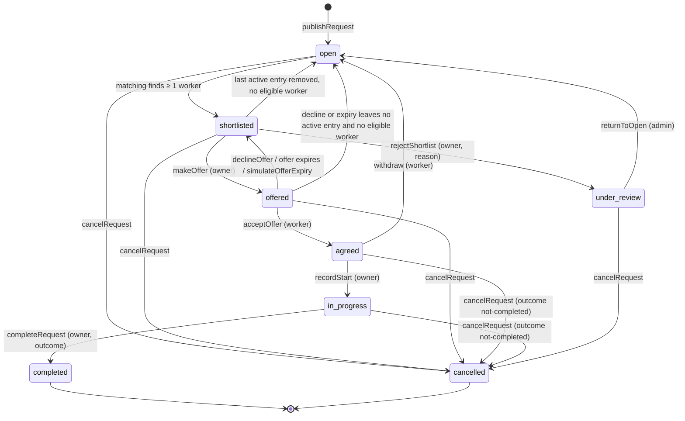

# Data Model: Job-Matching Marketplace

**Feature**: `001-job-matching-marketplace` | **Date**: 2026-11-12 | **Plan**: [plan.md](./plan.md)

All data lives in one `DemoState` object in the browser (see [research.md §7](./research.md#7-application-state-and-persistence)). It is split into a **frame** part, shared by every feature, and one part per feature. `002-shared-knowledge-base` adds a `knowledgeBase` part next to `marketplace` and reuses `frame` unchanged (constitution principle I).

Conventions:

- `Id` is a string. Seed records use readable IDs (`person-3`); records created during a demo use UUIDs.
- `IsoDate` is `YYYY-MM-DD`. `IsoDateTime` is an ISO 8601 timestamp with a UTC offset.
- `Actor` is a person's `Id` or the literal `"system"` for automatic events, shown as "System" (FR-010, clarification on automatic events).
- Every field listed is required unless marked optional (`?`).

```text
DemoState
├── meta        { seedId, anchorDate, loadedAt }
├── frame       { people[], businesses[], skills[], activity[] }
└── marketplace { workerProfiles[], requests[], conversations[], crawlCatalog[], crawlRuns[] }
```

---

## Frame entities (shared by every feature)

### Person (Simulated User)

A fictional person the user switcher can select. Every person comes from the seed data; none are created during a demo (FR-036).

| Field | Type | Notes |
|---|---|---|
| `id` | `Id` | |
| `name` | string | Full Norwegian name. |
| `isVaroddAdmin` | boolean | Varodd administrator role. |
| `seeksWork` | boolean | The person is looking for work and can register a worker profile, or be referred through NAV, in feature 001. |
| `description` | string | One short line shown in the user switcher, such as "Eier av Fjordlys Keramikk". |

Roles are **worked out from the data**, not stored, so the same rules work in every feature:

- **Business owner**: `business.ownerId === person.id`.
- **Person working at a business**: listed in `business.employeeIds`, or the owner, or placed there through feature 001 (see `peopleWorkingAt` below).
- **Worker**: has a `WorkerProfile`.
- **Varodd administrator**: `isVaroddAdmin`.

### Business

One list of businesses, shared with `002-shared-knowledge-base` (clarification: "There is one list of businesses").

| Field | Type | Notes |
|---|---|---|
| `id` | `Id` | |
| `name` | string | |
| `description` | string | Short description of what the business sells. |
| `ownerId` | `Id` → Person | Exactly one owner. |
| `employeeIds` | `Id[]` → Person | Other people working there from the seed data, 0–2 (1–3 people in total including the owner). |
| `isEWavesMember` | boolean | E-Waves membership. Used by 002. |
| `crawlOptIn` | boolean | Changed only by the owner (FR-021). |
| `crawlSuggestions` | `Id[]` → Skill | Suggestions from the most recent simulated crawl. Empty if never crawled. |
| `crawlSuggestionsUpdatedAt?` | `IsoDateTime` | |

**Derived** `peopleWorkingAt(business, state)`: the owner, the `employeeIds`, plus each worker whose request for this business is In progress, or Completed with outcome `permanent` (spec edge case on placement). In feature 001, only the owner acts for the business. In feature 002, everyone in this list is an E-Waves member if the business is one.

### Skill

An entry in the one shared Norwegian skill list (FR-020). Fixed in the seed data and not editable.

| Field | Type | Notes |
|---|---|---|
| `id` | `Id` | |
| `name` | string | Norwegian, such as "Produktfotografering". |

### ActivityEntry

Something that happened in any feature, shown in the activity feed on the home page (FR-030). Activity entries are only ever added, never changed or removed.

| Field | Type | Notes |
|---|---|---|
| `id` | `Id` | |
| `at` | `IsoDateTime` | Real time. |
| `featureId` | string | `"marketplace"` for this feature; 002 uses its own ID. |
| `actor` | `Actor` | |
| `text` | string | Norwegian sentence shown in the feed, such as "Fjordlys Keramikk har fått en kortliste med 3 kandidater". |
| `target` | `{ route: string }` | The page to open when the entry is clicked, such as `/oppdrag/oppdrag-2`. |
| `audience` | `Audience` | Who may see the entry. |

`Audience` is `{ personIds: Id[]; groups: AudienceGroupId[] }`. A person sees an entry if they are in `personIds`, belong to one of `groups`, or are a Varodd administrator. Groups are checked when the feed is shown, not when the entry is created, so a group's members can change. Feature 001 registers one group, `"marketplace.workers"` (every person with a non-draft worker profile), used for "new Open request" entries, because workers can see all Open requests (FR-037). Feature 002 registers its own groups (see [contracts/shared-frame.md](./contracts/shared-frame.md#activity-feed)).

Audience rules for feature 001 entries:

| Event | Audience |
|---|---|
| Request published, or returned to Open | Owner + `marketplace.workers` |
| Shortlist created or changed | Owner + each worker added |
| Interview invitation, offer | Owner + that worker |
| Offer accepted, declined, or expired | Owner + that worker |
| Message sent | The two conversation participants only |
| Shortlist rejected, Under review, Cancelled | Owner + every worker with an active shortlist entry at that moment |
| Started, Completed, Withdrawn | Owner + the agreed worker |
| NAV referral created | The referred person |
| Crawl finished | The owner of each crawled business |
| Worker profile became eligible | The worker |

---

## Marketplace entities (feature 001)

### WorkerProfile

A person seeking work (FR-002, FR-018). At most one per person.

| Field | Type | Notes |
|---|---|---|
| `personId` | `Id` → Person | Must have `seeksWork: true`. |
| `skillIds` | `Id[]` → Skill | |
| `experienceLevel?` | `"junior" \| "mid" \| "senior"` | Shown to the owner only; never used in matching (FR-003). Norwegian labels: Junior, Erfaren, Senior. |
| `availableFrom?` | `IsoDate` | The earliest date the person can start. |
| `wishes?` | string | Optional free text: what they would like to do. |
| `isDraft` | boolean | `true` for a NAV draft that is not yet complete. |
| `navReferral?` | `{ referredAt: IsoDateTime; simulated: true }` | Present if referred through NAV. Shown to owners (FR-019), never used in ranking. |
| `eligibleSince?` | `IsoDateTime` | Set when the profile first becomes eligible. Final tie-breaker in ranking. |
| `lastShortlistedAt?` | `IsoDateTime` | Updated whenever the worker is added to any shortlist. |

**Validation**: A profile is **complete** when it has at least one skill, an `experienceLevel`, and an `availableFrom`. A complete profile always has `isDraft: false`. Registering a profile, or completing a NAV draft, sets `isDraft: false` and sets `eligibleSince` if it is not already set.

**Derived** `isBusy(worker, state)`: the worker is the agreed worker on any request with status Agreed or In progress.

**Derived** `isEligibleForMatching(worker, state)`: complete, not a draft, and not busy.

### TaskRequest

Work requested by a business owner (FR-001).

| Field | Type | Notes |
|---|---|---|
| `id` | `Id` | |
| `businessId` | `Id` → Business | |
| `title` | string | Short title, 1–100 characters. |
| `description` | string | 1–4000 characters. |
| `requiredSkillIds` | `Id[]` → Skill | At least 1. Only these are used for matching (FR-023). |
| `acceptedSuggestionIds` | `Id[]` → Skill | Which pre-filled crawl suggestions the owner kept. Kept for the record; matching uses `requiredSkillIds` only. |
| `additionalRequirements?` | string | Free text. Never used in matching (FR-003). |
| `desiredStartDate` | `IsoDate` | |
| `estimatedDuration` | `{ amount: number; unit: "weeks" \| "months" }` | Whole number, `amount ≥ 1`. |
| `hoursPerWeek` | number | Whole number, 1–60. Never used in matching. |
| `workLocation` | `"remote" \| "onsite"` | Norwegian labels: Fjernarbeid, På stedet. Never used in matching. |
| `status` | `RequestStatus` | See the status flow below. |
| `createdAt` | `IsoDateTime` | Publishing time. Requests are published straight away; there are no drafts. |
| `shortlist` | `ShortlistEntry[]` | Every worker ever listed, including removed entries. |
| `excludedWorkerIds` | `{ workerId: Id; reason: ExclusionReason; at: IsoDateTime }[]` | Workers who must never be listed for this request again (FR-008). |
| `offeredWorkerId?` | `Id` | Set while status is Offered. |
| `agreement?` | `{ workerId: Id; ownerAgreedAt: IsoDateTime; workerAgreedAt: IsoDateTime }` | Recorded when the status becomes Agreed (FR-006). The owner's agreement is the time they made the offer. |
| `actualStartDate?` | `IsoDate` | Recorded by the owner; moves the status to In progress. |
| `outcome?` | `"as-planned" \| "extended" \| "permanent" \| "not-completed"` | `not-completed` is set when a request is cancelled after Agreed. |
| `rejection?` | `{ reason: string; at: IsoDateTime }` | The most recent whole-shortlist rejection (FR-009). |
| `cancellation?` | `{ reason: string; at: IsoDateTime; by: Id }` | |
| `log` | `LogEvent[]` | Only ever added to. |

`ExclusionReason` is `"declined" | "offer-expired" | "withdrew" | "shortlist-rejected"`.

**Validation**:

- `title`, `description`, at least one required skill, `desiredStartDate`, `estimatedDuration`, `hoursPerWeek`, and `workLocation` are required.
- **Duration notice** (FR-014): shown, without blocking, when the duration is less than 2 weeks or more than 6 months, meaning `weeks` with `amount < 2` or `amount > 26`, or `months` with `amount > 6`.
- Editing is allowed only while `status` is Open (FR-015).

### ShortlistEntry

A worker listed for a request.

| Field | Type | Notes |
|---|---|---|
| `workerId` | `Id` → WorkerProfile.personId | |
| `rank` | number | 1-based position when added. Entries are shown sorted by rank. |
| `addedAt` | `IsoDateTime` | |
| `matchedSkillIds` | `Id[]` | Worked out when the entry is added. |
| `missingSkillIds` | `Id[]` | |
| `interviewInvitedAt?` | `IsoDateTime` | Inviting does not change the status (US2-4). |
| `state` | `"active" \| "offered" \| "removed"` | |
| `removedReason?` | `ExclusionReason \| "accepted-elsewhere"` | `accepted-elsewhere` removes the entry without excluding the worker from the request. |

At most 3 entries are `active` or `offered` at a time.

### Conversation

Messages between the owner and one worker about one request (FR-011). Created when the worker is first added to the shortlist.

| Field | Type | Notes |
|---|---|---|
| `id` | `Id` | |
| `requestId` | `Id` → TaskRequest | |
| `ownerId` | `Id` → Person | |
| `workerId` | `Id` → Person | |
| `messages` | `{ id: Id; at: IsoDateTime; authorId: Id; text: string }[]` | Only ever added to. `text` 1–2000 characters. |

**Visibility**: only `ownerId`, `workerId`, and Varodd administrators.

**Who can send**: the owner and the worker, while the request is not Completed or Cancelled and the worker's entry is not removed, or the worker is the agreed worker.

### LogEvent

A permanent record of something that happened on a request (FR-010).

| Field | Type | Notes |
|---|---|---|
| `id` | `Id` | |
| `at` | `IsoDateTime` | Always real time (FR-033). |
| `actor` | `Actor` | |
| `kind` | `LogEventKind` | See the list below. |
| `text` | string | Norwegian sentence shown in the log. |
| `workerId?` | `Id` | The worker the event concerns, if any. |
| `fromStatus?`, `toStatus?` | `RequestStatus` | For status changes. |
| `simulated?` | `true` | Set when the event was caused by a time debug button. Its `text` then says "Simulert med feilsøkingsknappen". |

`LogEventKind`: `published`, `edited`, `duration-notice`, `shortlisted`, `shortlist-entry-removed`, `interview-invited`, `offered`, `offer-accepted`, `offer-declined`, `offer-expired`, `shortlist-rejected`, `returned-to-open`, `started`, `completed`, `withdrew`, `cancelled`, `message-sent`, `status-changed`.

**Visibility on the request page**: the owner and Varodd administrators see every event. A worker sees only events with their own `workerId` and status-change events. Message text never appears in the log, only that a message was sent between two named people.

**Immutability**: no command changes or removes a `LogEvent`. A domain test checks that, for every command, the log before the command is an unchanged prefix of the log after it.

### CrawlCatalogEntry and CrawlRun

The simulated crawl (FR-022) cannot read real websites (principle II). It reads prepared, fictional results from the seed data instead.

| CrawlCatalogEntry field | Type | Notes |
|---|---|---|
| `businessId` | `Id` → Business | |
| `rounds` | `Id[][]` → Skill | Skill suggestions for crawl run 1, 2, 3, … Run *n* uses `rounds[(n − 1) mod rounds.length]`, so running the crawl again can change the suggestions (US5-6). |

| CrawlRun field | Type | Notes |
|---|---|---|
| `id` | `Id` | |
| `at` | `IsoDateTime` | |
| `by` | `Id` → Person | A Varodd administrator. |
| `crawledBusinessIds` | `Id[]` | Only businesses with `crawlOptIn: true` at that time. |
| `skippedBusinessIds` | `Id[]` | Businesses not opted in. |
| `simulated` | `true` | Shown as a "Simulert" label. |

A crawl only replaces `business.crawlSuggestions`. Existing requests keep their skills (US5-6).

---

## Request status flow

`RequestStatus` is one of `open`, `shortlisted`, `offered`, `agreed`, `in-progress`, `completed`, `cancelled`, `under-review` (FR-007). Norwegian labels: Åpen, Kortliste klar, Tilbud sendt, Avtalt, Pågår, Fullført, Avlyst, Til vurdering.



Each transition, with its permissions and side effects, is defined in [contracts/commands.md](./contracts/commands.md).

---

## Matching rules (FR-003, FR-017, spec edge cases)

Matching is one pure function, `fillShortlist(request, state, now)`, run for one request at a time.

1. **Runs when**: a request is published, edited while Open, or returned to Open; a worker profile becomes eligible; a worker becomes free again (their agreed request is Completed or Cancelled, or they withdraw); an active entry is removed (decline, expiry, accepted elsewhere). It runs only for requests with status Open, Shortlisted, or Offered.
2. **Candidates**: every worker where `isEligibleForMatching` is true, who is not in `excludedWorkerIds` for this request, and has no `active` or `offered` entry on it.
3. **Eligible** if `matchedSkills / requiredSkills ≥ 0.5` and `availableFrom ≤ desiredStartDate`.
4. **Ranking** (spec edge case on more than 3 workers):
   1. Higher share of required skills first.
   2. Earlier `availableFrom` first.
   3. Longer since `lastShortlistedAt` first. A worker never shortlisted counts as waiting the longest.
   4. Earlier `eligibleSince` first.
   5. Lower `personId` (string order) first, so the result is always the same for the same data.

   Experience level, NAV referral, hours per week, work location, and additional requirements are not inputs to the function at all (FR-003, FR-019, US2-10).
5. **Fill**: add candidates in ranked order until the request has 3 `active` or `offered` entries. Each added worker gets a new entry, `lastShortlistedAt = now`, and a conversation with the owner if none exists yet.
6. **Status**: an Open request with at least 1 entry after filling becomes Shortlisted. A Shortlisted request with 0 `active` entries after filling becomes Open. An Offered request keeps its status while filling.
7. **Order across requests**: when one event affects several requests (for example, a newly eligible worker), requests are filled in `createdAt` order, oldest first, so the result is always the same.

When a worker **accepts** an offer, their `active` entries on other requests are removed with reason `accepted-elsewhere` (not excluded), any other `offered` entries for them count as declined (excluded with reason `declined`, and those requests return to Shortlisted), and every affected request is filled again (US3-6).

---

## Seed data requirements

From the spec's Assumptions, SC-002, SC-004, and SC-005. Checked by tests on the generated file.

- About 5 businesses, each with 1–3 people working there; at least 2 opted in to crawling, at least 1 not; at least 2 E-Waves members (for 002).
- Every opted-in business has non-empty `crawlSuggestions` from the seed's initial crawl (SC-004); no other business does.
- A few workers: complete profiles, at least 2 NAV-referred, at least 1 person with `seeksWork` and no profile (registration demo), at least 1 with `seeksWork`, no profile, and no NAV referral (NAV referral demo).
- At least 1 Varodd administrator.
- Requests in every status, including: one with a full shortlist of 3, one with a shortlist of 1 or 2, one Open with no eligible worker (SC-002), one Offered (for the debug button), one Under review, and one already taken through to Completed with a full log (SC-003).
- A history containing exclusions, to demonstrate SC-005.
- Activity entries matching the seeded history, so the feed looks populated.
- The seed is generated so that the seeded shortlists match what `fillShortlist` would produce from the seeded profiles. A test checks this.
